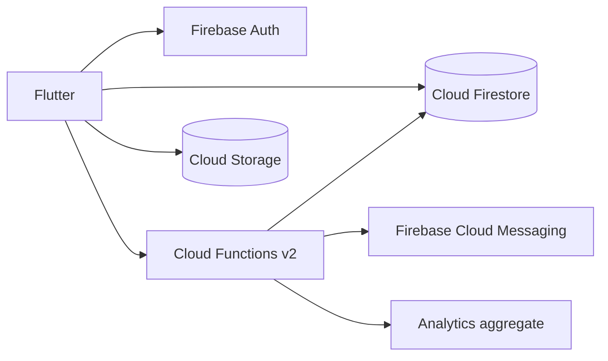

# ReShare Firebase Backend

Production-oriented Firebase backend for the ReShare Flutter application in Sri Lanka.

## Architecture



Flutter uses Firebase Auth for phone, email, and Google sign-in. It calls the exported callable functions for business operations. Firestore and Storage rules remain deny-by-default; privileged mutations happen in the Admin SDK inside Functions.

## Setup

1. Install Node.js 20, Firebase CLI, and Java 11+ for the emulator suite.
2. Create a Firebase project, enable Auth providers (Phone, Email/Password, Google), Firestore, Storage, FCM, App Check, Analytics, Crashlytics, and Remote Config.
3. Replace `your-firebase-project-id` in `.firebaserc`.
4. Run `firebase login`, then `cd functions && npm install`.
5. Copy `functions/.env.example` to `functions/.env` and set project-specific values.
6. Deploy with `firebase deploy --config firebase.json` from this directory.

## Local development

```bash
cd functions
npm install
npm run build
cd ..
firebase emulators:start --only auth,functions,firestore,storage
```

Use the Firebase Flutter emulator connectors during local development. Never use production credentials in the emulator.

## Authentication contract

The Flutter app must use the Firebase Auth SDK for OTP delivery and verification (`verifyPhoneNumber`), email verification/password reset, and Google OAuth. `sendPhoneOtp` validates the Sri Lankan `+94XXXXXXXXX` contract and returns the client action; Firebase Auth, not a server callable, sends the SMS. After client verification, `verifyPhoneOtp` syncs the verified phone flag.

Set admin claims from a secured operator environment only:

```ts
await getAuth().setCustomUserClaims(uid, { role: 'admin' });
```

Supported claims are `user`, `moderator`, and `admin`; clients must refresh their ID token after a claim change.

## Firestore schema

`users/{userId}` stores profile, language, location, verification flags, impact counters, and role. `users/{userId}/fcmTokens/{token}` stores device registration. `users/{userId}/notifications/{notificationId}` stores notification history.

`items/{itemId}`: `ownerId`, `title`, `description`, `category`, `condition`, `images[]`, `location { city, district, province, lat, lng }`, `tags[]`, `status`, `claimsCount`, `createdAt`, `updatedAt`.

`claims/{claimId}`: `itemId`, `donorId`, `claimantId`, `status` (`pending`, `accepted`, `rejected`, `completed`), timestamps.

`requests/{requestId}`: `requesterId`, `title`, `description`, `reason`, `urgency`, `supportingDocuments[]`, `status` (`open`, `fulfilled`, `closed`), timestamps.

`verifications/{verificationId}`: `userId`, `type` (`student`, `ngo`, `nationalId`), `documents[]`, `status` (`pending`, `approved`, `rejected`), timestamps.

`impactMetrics/{userId}` stores `itemsShared`, `itemsReceived`, `requestsFulfilled`, `co2SavedKg`, `badges[]`. It is written only by trusted Functions.

## Callable API

| Function | Purpose |
| --- | --- |
| `createUserProfile`, `updateProfile`, `getCurrentUser`, `deleteUser` | Profile lifecycle |
| `createItem`, `updateItem`, `deleteItem`, `getItem`, `getMyItems`, `searchItems` | Item lifecycle and discovery |
| `claimItem`, `acceptClaim`, `rejectClaim`, `completeClaim` | Claim workflow |
| `createRequest`, `updateRequest`, `closeRequest`, `fulfillRequest` | Community requests |
| `uploadAvatar`, `uploadVerificationDocuments` | Finalize Storage uploads |
| `saveFcmToken`, `sendNotification`, `markNotificationRead`, `markAllNotificationsRead` | Notifications |
| `approveVerification`, `rejectVerification` | Admin moderation |
| `calculateImpact`, `assignBadges` | Impact and badges |

Callables require an authenticated Firebase user unless documented as an admin operation. Errors use standard `HttpsError` codes.

## Storage

The Flutter client uploads to `avatars/{uid}/`, `items/{uid}/`, `requests/{uid}/`, or `verification/{uid}/`. Files are limited to 10 MB and `image/jpeg`, `image/png`, `image/webp`, or `application/pdf`. Use Firebase download URLs in the corresponding document. Verification files are readable only by the owner or an admin.

## Deployment and CI

```bash
firebase deploy --only firestore:rules,firestore:indexes,storage
firebase deploy --only functions
```

The workflow in `.github/workflows/firebase.yml` installs Functions dependencies, builds TypeScript, and deploys on pushes to `main`. Store `FIREBASE_TOKEN` or workload identity credentials in GitHub Actions secrets; do not commit service-account JSON.

## Cost and security notes

- Paginate every feed and keep callable limits bounded; the included search limit is 50.
- Keep Analytics and Crashlytics enabled in Flutter, but aggregate admin dashboard counters daily rather than scanning collections per request.
- App Check enforcement should be enabled after registering all production Flutter app IDs and completing rollout monitoring.
- Rules protect direct client access, while Functions enforce state transitions and custom claims.
- Review indexes and scheduled-job volume in the Firebase usage console before increasing limits.